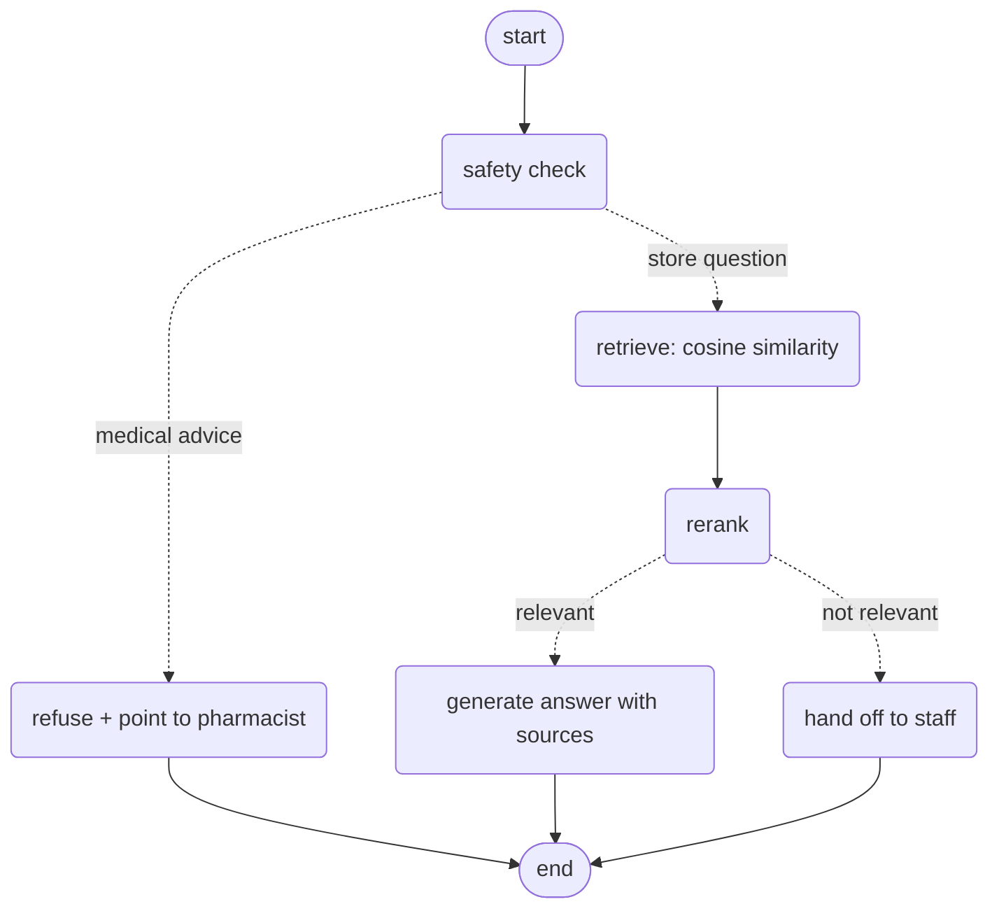

# CareWell Support Bot

[](https://github.com/Nitesh-bit1991/carewell-support-bot/actions/workflows/ci.yml)

A small customer-support chatbot for a **fictional medical store**, built as a RAG pipeline with **LangGraph**. It answers questions about opening hours, delivery, prescriptions, payment and returns **only from the store's own documents**, refuses to give medical advice, and hands the customer to a human when it is unsure.

> The store, phone numbers and policies are invented for this demo. The idea comes from a real family pharmacy, where the same questions come up every day. Do not use this application for real customer or patient support.

## Why this design

A support bot for a medical store has two failure modes that matter: inventing store policies, and giving medical advice. The pipeline is built around avoiding both.



1. **Safety check**: rule-based filter for dosage, side-effect, interaction and "which medicine" questions. These get a refusal that points to the pharmacist (and mentions emergencies).
2. **Retrieve**: cosine similarity between TF-IDF vectors of each document section and the question (top 6).
3. **Rerank**: reorders candidates and keeps the best 3. The default is a lightweight lexical reranker. An optional neural cross-encoder can be enabled (see below).
4. **Relevance gate**: if the best cosine score is below the configured threshold, the bot hands the question to staff instead of guessing.
5. **Generate**: Claude writes a short answer using the retrieved text and cites the source file. Without an API key, the bot quotes the best passage, so the demo runs without paid API access.

## Run it

```bash
git clone https://github.com/Nitesh-bit1991/carewell-support-bot
cd carewell-support-bot
pip install -r requirements.txt

streamlit run app.py                        # chat UI
python -m support_bot "Is delivery free?"   # command line
```

For generated answers instead of quoted passages, set `ANTHROPIC_API_KEY` in your environment. Never commit API keys.

Optional neural reranker (downloads a model on first use):

```bash
pip install -r requirements-neural.txt
python -m support_bot --reranker cross-encoder "Do you sell baby products?"
```

## Tests and evaluation

Run the automated tests:

```bash
pip install -r requirements-dev.txt
pytest -q
```

Run the offline retrieval and routing evaluation (no API key required):

```bash
python eval/run_eval.py
```

The evaluation uses 23 questions: 15 answerable store questions, 3 out-of-scope questions and 5 medical-advice questions. It compares cosine-only retrieval with cosine plus the lexical reranker.

| Setup | Top-1 correct source | In top 3 | Correct refusals / hand-offs |
|---|---:|---:|---:|
| Cosine only | 14 / 15 | 15 / 15 | 7 / 8 |
| Cosine + lexical reranker | 14 / 15 | 15 / 15 | 7 / 8 |

**Honest reading of these numbers**

- The test set is small and was written for this project, so treat it as a sanity check, not a benchmark.
- The lexical reranker did **not** change the results on this test set. It is dependency-free, but it is not the reason the bot works.
- **Failure 1:** "Do you sell baby products?" ranks `delivery.md` above `products.md`. TF-IDF favours short sections that repeat "products" over a longer section that mentions babies. The expected document is still in the top 3.
- **Failure 2:** "Do you offer car rental?" is answered with the payment section because "offer" matches "we do not offer purchases on credit". Scores for this false match overlap with scores for correct answers, so a single threshold does not fix it.
- Both failures come from matching words rather than meaning. The next experiment is embedding-based retrieval plus a cross-encoder reranker, evaluated on a larger question set.

The existing GitHub Actions CI workflow runs the unit tests and offline evaluation on pushes and pull requests.

## Limitations

- The medical-advice filter is a list of patterns. It can miss unusual phrasings and may over-block some questions. A real deployment would need a stronger safety classifier and review by a qualified pharmacist.
- Documents are split by heading, one chunk per section. This works for short help pages but not long documents.
- The neural cross-encoder is optional and is not included in the evaluation results above.
- Claude generation depends on an external API and may incur usage costs. Without a key, the application uses extractive fallback rather than a generated answer.
- The demo must never be used to give actual medical guidance.

## Project layout

```text
app.py                    Streamlit chat UI
support_bot/graph.py      LangGraph workflow
support_bot/retrieval.py  TF-IDF cosine retrieval and rerankers
support_bot/safety.py     medical-advice filter
support_bot/generation.py answer writing (Claude or quoted passage)
data/docs/                fictional store help documents
eval/                     questions and evaluation script
tests/                    unit tests
.github/workflows/        automated CI
```

## Built with AI assistance

I built this project with help from Claude (Anthropic), which drafted much of the code, the store documents and the evaluation questions. I chose the use case and design direction (LangGraph, cosine retrieval with a reranker, and a medical-advice safety check) and ran the project myself.

## License

MIT
